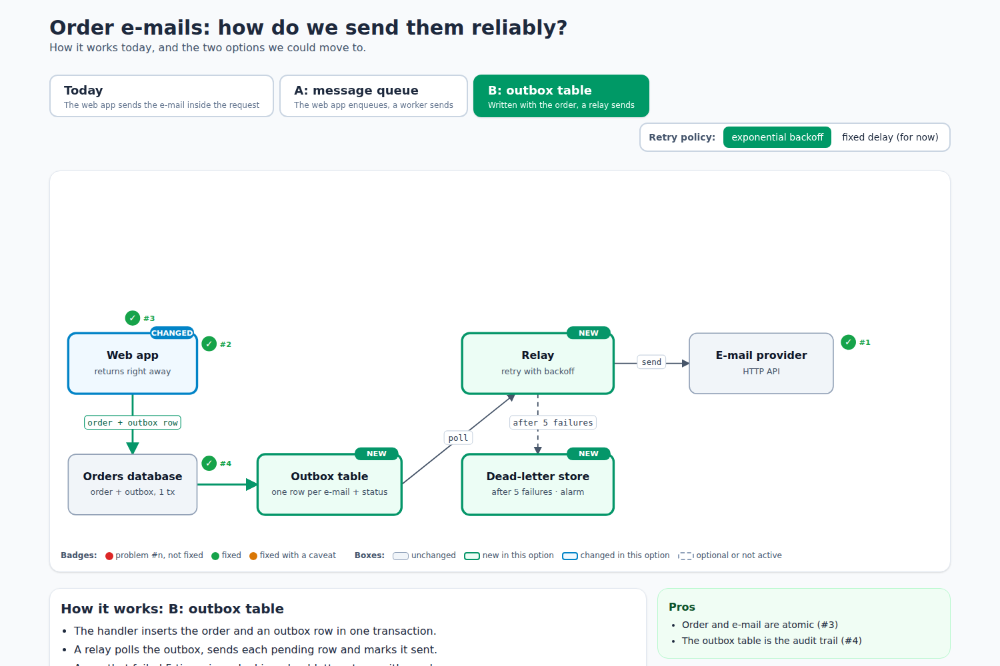
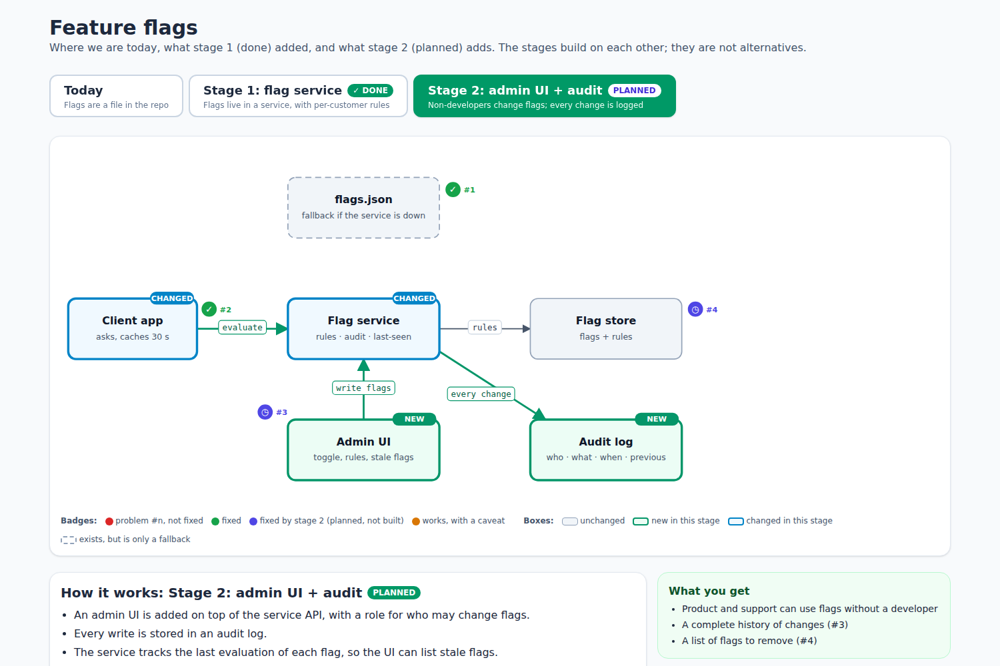

# pres-skill

An agent skill that turns a design doc, or the design discussion you just had, into an **interactive presentation page** you can share on screen in a meeting.

One diagram, redrawn for each option or stage, over the same list of problems and scenarios:



- **Diagram per option or stage.** Boxes keep their place from one option to the next, so the room can compare by flipping (keys 1–9, ← →). Grey = unchanged, green = new, blue = changed.
- **Numbered problems**, each with a status per option, and the badge on the diagram follows it.
- **Scenario × option matrix**, pros and cons, notes, open questions.
- **Two modes**: *alternatives* (compare options, nothing pre-selected) and *stages* (steps that build on each other, `DONE` or `PLANNED`).
- **Single-file export** (`npm run build:single`) for Confluence, Jira or mail.
- **A layout checker** (`npm run check:layout`) that tests every option × variant for overlaps and text that doesn't fit, and **screenshots** (`npm run screenshot`) so the agent can look at the result.



## What this is, and isn't

It is a **starting point to edit**, not a framework. The skill ships a small working app (`template/`) with fictional content. The agent replaces the content in `data.ts` and `diagramSpec.ts`, and edits any code that is specific to your presentation (an extra section, another diagram). `App.tsx` and `Diagram.tsx` are generic, so most presentations never touch them.

It isn't a slide deck generator: the output is a web page. For `.pptx` or Google Slides use another tool.

## Install

**In Claude Code**, as a plugin (this repo is its own marketplace):

```
/plugin marketplace add antonin-suzor/pres-skill
/plugin install pres-skill@pres-skill
```

**As a plain skill**, in any harness that reads `SKILL.md` folders (the Agent Skills format): copy `skills/interactive-presentation/` into its skills directory, for example `~/.claude/skills/` (for you) or `.agents/skills/` in a repo (for the team).

**In any other agent** (Cursor, Copilot, Codex, a local model...): the whole workflow is plain Markdown in [`skills/interactive-presentation/SKILL.md`](skills/interactive-presentation/SKILL.md), and [`AGENTS.md`](AGENTS.md) at the root points to it. Add a line to your agent's instructions file, or just tell it: "read `skills/interactive-presentation/SKILL.md` and follow it". Nothing in the template depends on a particular agent. Viewing the screenshots needs a model that can read images; without that, the layout checker still catches the geometry problems.

## Use

Ask your agent, with the design doc open or after you discussed the design:

> Make a presentation of this design for the team. Alternatives mode, three options to compare.

or

> Present the three stages of this rollout: stage 1 is done, stage 2 and 3 are planned.

The agent reads the doc, builds the page in a gitignored folder, verifies the claims against your code, runs the checks, looks at the screenshots, and tells you the commands to start it.

Requirements: Node 22 or newer (tested on 26) and npm. A headless Chrome or Chromium is optional (for screenshots).

## Try the template without an agent

```bash
cp -r skills/interactive-presentation/template /tmp/my-pres && cd /tmp/my-pres
npm install
npm run dev              # http://localhost:5173
npm run verify           # typecheck + layout check
npm run build:single     # presentation.html
```

For the stages example: `cp skills/interactive-presentation/examples/stages/src/*.ts /tmp/my-pres/src/`.

## Layout of this repo

```
.claude-plugin/                       plugin + marketplace manifests (Claude Code only)
AGENTS.md                             neutral entry point for any agent
skills/interactive-presentation/
  SKILL.md                            what the agent reads
  references/                         content rules, diagram layout, extending the template
  template/                           the working app (alternatives example)
  examples/stages/src/                data + diagram for the stages mode
docs/                                 screenshots
```

## Contributing

Generic improvements are welcome: a better layout checker, new statuses, helpers, new example modes. Keep `npm run verify` green on both examples, and keep the template free of anything company-specific.

## License

MIT
